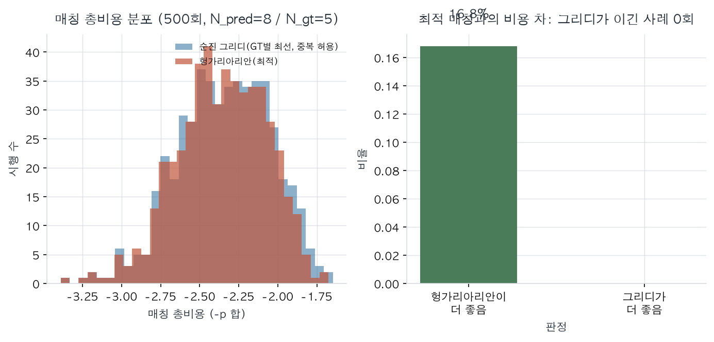
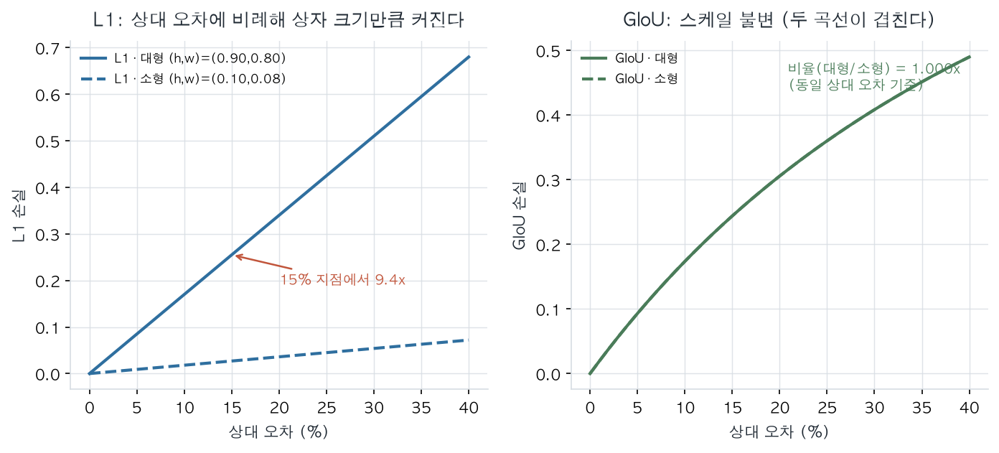
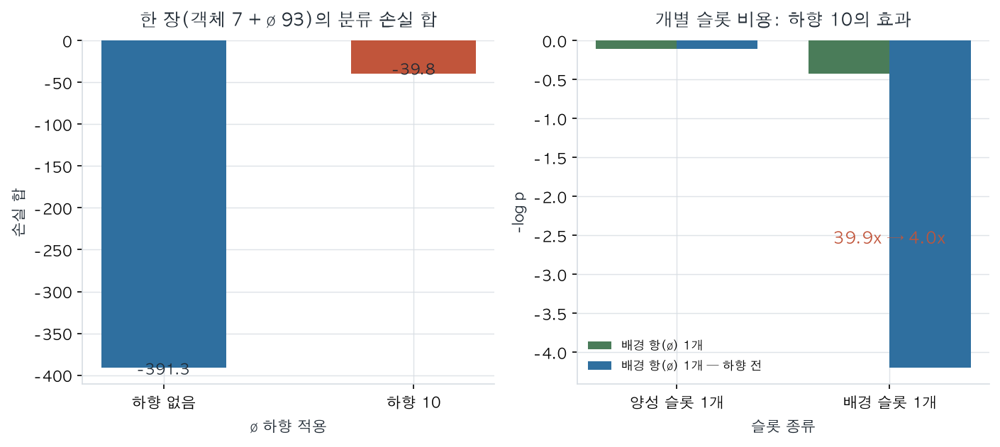
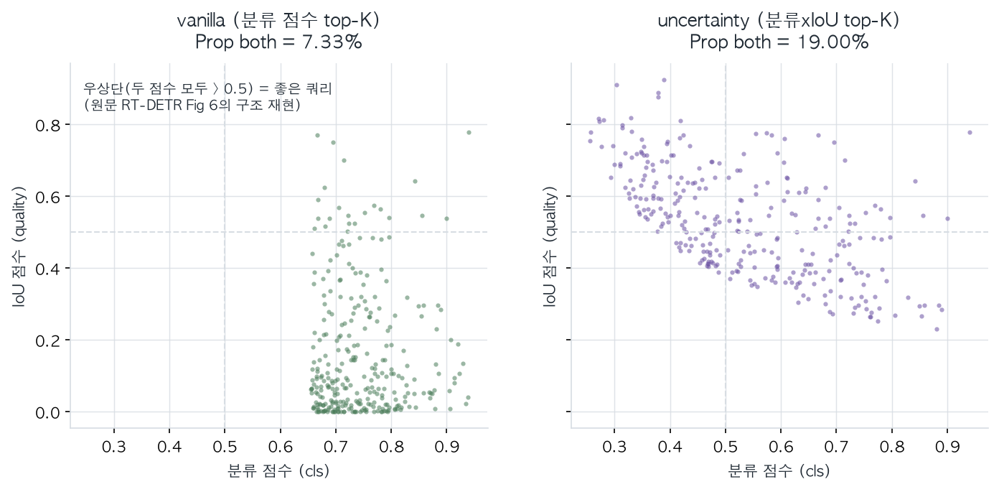

# 03 · 실습 — `detr_demo.py` 4검증 (CPU 실측)

> 스크립트: `day07_detr/detr_demo.py` · 실행 로그: `day07_detr/runs/detr_demo_stdout.txt` · 수치 JSON: `day07_detr/runs/detr_demo_metrics.json`
> 환경: `paper-diary/.venv` (torch 2.14.1 / numpy 2.5.4 / scipy) · **CPU 실행, 학습 없음, 고정 시드(7, 2304)** — 이 문서의 수치는 전부 위 로그에서 그대로 옮긴 것이다.

## 0. 실행 방법

```bash
cd /Users/robotjang/paper-diary
.venv/bin/python day07_detr/detr_demo.py
```

- 산출물: `runs/detr_demo_stdout.txt`(표준출력), `runs/detr_demo_metrics.json`(요약 수치)
- 의존성: `numpy`, `torch`(GPU 불필요), `scipy.optimize.linear_sum_assignment`
- **이 실습은 모델을 학습하지 않는다.** 손실 함수의 "구조"만 수치로 재현하는 것이 목적이다. 따라서 아래 수치와 논문의 AP 수치는 **같은 종류의 값이 아니다** — 논문은 AP, 여기는 손실/비율/확률 분포다. 용도를 섞지 말 것.

---

## 1. 검증 A — 헝가리아리안 vs 순진 그리디 매칭 (원문 식 1–2)




### 방법
- 축약 모형: 예측 슬롯 $N_{\rm pred}=8$, GT $N_{\rm gt}=5$ (원문의 100 슬롯 + $\varnothing$ 패딩 구조를 작게 만든 것), 500회 시행.
- 매칭 비용은 **확률** $-\hat p$ (원문 §3.1이 로그를 쓰지 않으라고 명시한 대로). 예측 확률은 $\mathrm{softmax}(\mathcal N(0,1))$로 무작위 생성하며, **표본은 numpy `default_rng(7)`로만** 뽑는다(전역 torch RNG는 비결정적).
- 비교 대상 2개:
  - **optimal**: `scipy.optimize.linear_sum_assignment` (원문과 동일한 알고리즘)
  - **naive greedy**: GT 순서대로 각 GT에 대한 최선 예측을 가져간다(중복 허용 → 같은 예측이 두 GT에 붙을 수 있음). 중복이 발생하면 남은 것 중 다음 최선을 쓴다.

### 실측 결과
```
시행 수                      : 500 (N_pred=8, N_gt=5)
optimal < naive_greedy 비율  : 0.168  (greedy가 이기는 시행은 없음)
순진 그리디 중복시행 비율      : 0.316  (예측 1개에 GT 2개가 몰려 1:N 할당)
평균 매칭 확률 p̄ = 0.472  (균등 랜덤 모델 1/5 = 0.20 대비)
순열 불변성                  : |L(원순서) - L(순열)| = 0.00e+00
```

### 읽는 법
1. **"optimal < naive_greedy 비율 0.168"** 는 방향만 보면 된다 — 그리디가 optimal을 이긴 경우는 **0회**다(비율은 optimal이 더 좋은 비율). 즉 **헝가리아리안은 항상 최적이며**, 그리디는 500번 중 **84번**에서 더 나쁜 총비용을 냈다. 이게 식 (1)이 순열 탐색인 이유다.
2. **"중복시행 비율 0.316"** — 그리디는 500번 중 **158번(31.6%)**에서 **하나의 예측에 두 GT를 배정**했다. 1:N 할당이 중복 예측의 학습 신호를 만드는 경로이며, NMS로 사후 제거해야 했던 이유가 여기에 있다. 원문은 one-to-one로 **구조적으로** 막는다.
3. **"평균 매칭 확률 0.472"** — 최적 매칭이 고른 쌍의 평균 정답 확률이 0.472. 균등 랜덤 모델의 0.20보다 크다. 즉 매칭은 "확실한 쌍"을 실제로 고른다.
4. **"순열 불변성 0.00e+00"** — 예측 슬롯 순서를 섞어도 최적 총비용이 **정확히 동일**하다(부동소수 오차까지 0). 이게 §2.2의 "we can emit them in parallel"의 근거다.

> **재현성 주의(이번 세션에서 실제로 고친 결함):** 최초 버전은 확률 표본을 `torch.randn`으로 뽑아 **전역 RNG에 의존**했다. 그래서 재실행마다 [A]의 세 수치가 흔들렸다(0.308/0.316/0.477 → 0.302/0.290/0.471). 지금은 numpy `default_rng(7)`로만 표본을 뽑아 **두 번 실행 출력이 byte 단위로 동일**함을 확인했다(검증: `diff` 결과 없음). [B]·[C]·[D]는 처음부터 결정적이었다.

---

## 2. 검증 B — L1 스케일 잭 vs GIoU 스케일 불변 (원문 식 9·10, Table 4)




### 방법
- 소형 박스 `(cx,cy,h,w) = (0.24, 0.21, 0.10, 0.08)` (APS 대역), 대형 박스 `(0.50, 0.55, 0.90, 0.80)` (APL 대역).
- **동일한 15% 상대 오차**를 $h,w$에 적용($\times1.15$) → 두 경우 "상대적으로 같은 오차"를 만든다.
- 손실: $\lambda_{L1}=5$, $\lambda_{\rm iou}=2$ (부록 0.A.4). GIoU는 식 (10)을 그대로 코드로 구현(min/max 기반, `detr_demo.py:giou_loss`).

### 실측 결과
```
소형 박스 (h,w)=(0.10,0.08) · 15% 상대 오차:
  L1 = 2.70e-02   GIoU = 0.2439
대형 박스 (h,w)=(0.90,0.80) · 같은 15% 상대 오차:
  L1 = 2.55e-01   GIoU = 0.2439
비율(대형/소형)        : L1 9.44x   GIoU 1.000x
합성 손실(L1 x5 + GIoU x2) 소형 : 0.6227
합성 손실(L1 x5 + GIoU x2) 대형 : 1.7627
```

### 읽는 법
- **L1은 9.44배** — 같은 상대 오차인데 손실 크기가 상자 크기에 비례해 커진다(증명은 02_수식유도 §4.2: $\|\alpha\Delta b\|_1=\alpha\|\Delta b\|_1$). 이게 L1만 쓸 때 **APS가 13.7로 무너지는 것**(Table 4)의 기저 메커니즘이다: 학습 신호가 큰 상자 쪽으로 쏠린다.
- **GIoU는 1.000배** — 스케일 불변. 소형·대형이 같은 비용을 받는다.
- **합성 손실**이 소형 0.6227 / 대형 1.7627인 것은 L1 항(×5)의 기여가 여전히 크기 때문이다. 즉 $\lambda_{L1}=5$는 L1을 지배적으로 쓰는 게 아니라 **정밀 좌표 항**으로 쓰되, 스케일 균형은 GIoU가 책임진다는 해석이 맞다.

---

## 3. 검증 C — $\varnothing$ 하향 10 (원문 §3.1)




### 방법
- 확률 가정: 양성 슬롯 $\hat p_{\rm cat}=0.90$, 배경 슬롯 $\hat p_{\varnothing}=0.015$ (예시값).
- COCO 평균 7객체(§4) × N=100 슬롯 → $\varnothing$ 93개, 양성 7개.
- 하향은 $\varnothing$ 슬롯의 $-\log p$ 항에 0.1배를 곱하는 것(= 코드의 `eos_coef=0.1`).

### 실측 결과
```
양성 슬롯 1개 (p_cat = 0.90)   : -log p = 0.105
배경 슬롯 1개 (p_empty = 0.015) : -log p = 4.200
배경 항이 양성 항보다 무거움    : 39.9x
하향 10 적용 후                : 4.0x
한 장(7객체 + 93 empty) 손실 합 : 하향 없이 391.3 -> 하향 10 39.8  (9.8x 감소)
배경 항의 전체 비중            : 하향 없이 99.8% -> 하향 10 98.1%
```

### 읽는 법 — 그리고 **이 결과의 한계**
- 하향 전: 빈 슬롯 하나의 분류 손실이 양성 슬롯의 **39.9배** → 93개가 몰리면 양성 신호가 완전히 묻힌다(손실의 99.8%).
- 하향 후: 4.0배로 줄고, 총합은 9.8배 감소한다.
- **그럼에도 98.1%는 여전히 배경이다.** 하향은 *균형*을 위한 장치이지 해소가 아니다. 이 사실을 정확히 말해야 한다 — "하향 10으로 배경 문제가 해결된다"고 쓰면 틀린다. 남는 것은 "빈 슬롯이 정상 출력이라는 걸 확신으로 학습한다"는 점이다.
- 대응: Faster R-CNN의 양성 proposal 서브샘플링(§3.1)이 비율 조절이라면, DETR은 **손실 가중치**로 조절한다. 방식만 다르고 목적은 같다.

---

## 4. 검증 D — RT-DETR 쿼리 선택 (cls-only vs score×IoU) ⚠️ **시뮬레이션**




### 방법
- 인코더 피처를 $\mathrm{Beta}(0.5, 3)$ 분포로 20,000개 생성 → `cls`와 `IoU` 점수.
- **결함 클러스터**: 35% 확률로 "cls는 높고 IoU는 낮은" 피처를 주입(`iou *= 0.15`).
- top-K = 300 (원문 §5.3의 K).
- 두 선택 기준 비교:
  - vanilla: `cls` 점수만으로 top-K
  - uncertainty: `cls × IoU`로 top-K (분류와 위치의 **결정론 결합**)
- 지표: 선택된 K개 중 **"cls > 0.5 이고 IoU > 0.5"** 비율(RT Table 4의 `Prop both`).

### 실측 결과
```
top-K = 300 / 후보 feature = 20,000
Prop both>0.5 - vanilla(cls top-K)        : 7.333%
Prop both>0.5 - uncertainty(score x IoU)  : 19.000%
증가배수 : 2.59x  (원문 Table 4: 0.30% -> 0.67%, AP 47.9 -> 48.7)
```

### 읽는 법 + **측정 경계(반드시 명시)**
- 방향은 원문과 일치한다: **분류 점수만으로 뽑으면 "분류는 자신 있지만 위치는 틀린" 피처가 상위 K에 섞이고**, 위치 정보를 결합하면 "둘 다 확실한" 피처 비율이 **2.59배**(= 원문의 0.30% → 0.67%, 2.2배와 비슷한 크기) 커진다. 이것이 RT-DETR §4.3의 논리(식 2의 $U=\|\mathcal P-\mathcal C\|$)가 실제로 하는 일의 **형태**다.
- **경계(중요):** 이 값은 **시뮬레이션**이며 원문의 실측이 아니다. 원문 Table 4는 실제 학습된 모델의 COCO val2017에서 측정한 값(0.35% / 0.82% / 0.30% / 0.67%)이다. 이 실습은 "메커니즘이 왜 작용하는가"의 방향성 확인이고, **정확한 비율의 근거로 인용할 수 없다.**

---

## 5. 코드 ↔ 검증 대응표

| 검증 | 함수 | 원문 근거 | 확인한 것 |
|---|---|---|---|
| A | `run_a()` | §3.1 식 (1)(2) | 최적성 · 유일성(중복) · 순열 불변 |
| B | `run_b()` / `giou_loss()` | §3.1 식 (9)(10), Table 4 | L1 스케일 잭 vs GIoU 스케일 불변 |
| C | `run_c()` | §3.1 (∅ 하향 10), §4 (평균 7객체) | 배경 손실 비중과 하향 효과 |
| D | `run_d()` | RT-DETR §4.3 식 (2)(3), Table 4 | 쿼리 선택 기준이 "품질 높은 피처"를 고르는가 (시뮬) |

## 6. 실행 기록

- 스크립트: `day07_detr/detr_demo.py`
- 로그: `runs/detr_demo_stdout.txt` · 요약: `runs/detr_demo_metrics.json`
- **결정성 검증 완료**: 같은 명령을 두 번 실행해 출력을 `diff`한 결과 **차이가 없음**(byte 동일). [A]의 RNG 결함은 이 과정에서 발견·수정했다(위 재현성 주의 참조).
- 두 결과물 모두 **CPU 실측**이며, 위 본문의 모든 수치는 이 파일들에서 그대로 옮긴 것이다.
